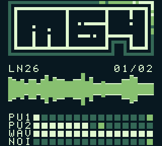

# lsdj-album

Turn your [LSDj](https://www.littlesounddj.com) songs into a stand-alone **Game Boy album ROM**:
your logo, your song names, a music visualizer, and your songs playing exactly as LSDj plays
them, on a real Game Boy, a flash cart or an emulator.

- **The real LSDj sound.** Songs are recorded from LSDj itself with
  [lsdpack](https://github.com/M64GitHub/lsdpack) and replayed register write by register write.
- **Works with current LSDj.** Tested with LSDj 9.3.9. This needed fixes in lsdpack, see below.
- **Your logo.** Any small PNG is scaled up and converted to Game Boy tiles.
- **A visualizer that follows the music.** LED meters for PU1, PU2, WAV and NOI, and a scrolling
  waveform, computed from what the player actually sends to the sound chip.
- **Album controls.** A = next song, B = previous song; songs move on by themselves when they end.

## Quick start

You need [RGBDS](https://rgbds.gbdev.io) 1.0, CMake (3.5+), a C++ compiler, Python 3 and make.
On macOS: `brew install rgbds cmake`.

    git clone --recursive https://github.com/M64GitHub/lsdj-album
    cd lsdj-album
    make SAVE=path/to/lsdj

`SAVE` is your LSDj ROM and its save without the extension: `path/to/lsdj` means
`path/to/lsdj.gb` and `path/to/lsdj.sav`. The first build also compiles lsdpack
(included as a git submodule). The result is `album.gb`.

Play it in any Game Boy emulator ([SameBoy](https://sameboy.github.io),
[Emulicious](https://emulicious.net), [mGBA](https://mgba.io), ...) or flash it to a cartridge.
On macOS with SameBoy installed, `make run` opens it.

Your `.gb` and `.sav` are never modified: recording happens on copies in `work/`.

## Preparing your songs

lsdpack records each song until LSDj stops playing, so **every song needs an `HFF` command
where it ends** (in a phrase on the last row of the song). Songs are recorded in slot order.

    make songs                 # list the songs in the save
    make info SLOT=3           # song rows in use, and where HFF commands are (phrases and tables)

Tips:

- Make a copy of your save that holds just the album's songs, or leave slots out with
  `SKIP="2 5"`.
- A song without `HFF` can be cut instead: `LENGTH=240` stops recording after 240 seconds (it
  applies to every song in the build, so it is best for one-song ROMs: `ONLY=3 LENGTH=240`).
- lsdpack starts each song from the top of the song screen, so a song should begin at row 00.

## Settings

Put them in `config.mk` (copy [`config.mk.example`](config.mk.example); it is ignored by git) or
pass them on the command line.

| Variable  | Default            | Meaning |
|-----------|--------------------|---------|
| `SAVE`    | (required)         | LSDj ROM + save, without extension |
| `SKIP`    |                    | song slots to leave out, e.g. `7 9` |
| `ONLY`    |                    | record only this slot |
| `LENGTH`  |                    | cut each song after this many seconds |
| `NAME`    | `album`            | output file name (`NAME.gb`) and work folder |
| `TITLE`   | `LSDJ ALBUM`       | title in the ROM header (up to 16 characters) |
| `LOGO`    | `assets/logo.png`  | logo image |
| `LSDPACK` | `lsdpack`          | lsdpack source folder (the submodule) |

After changing `SKIP`, `ONLY` or `LENGTH`, run `make clean` (or use another `NAME`).

### Logo

An 8-bit RGB or RGBA PNG. It is scaled up by the largest whole number that fits 160×56 pixels
(the 48×18 example logo becomes 144×54), then reduced to the Game Boy's four shades by
brightness; transparent pixels become black, the background colour. The logo can use about
160 different 8×8 tiles.

## On a real Game Boy

The ROM is an MBC5 cartridge image (no save RAM); its size depends on the songs, about
1.5 KB per second of music. It is a DMG ROM; Game Boy Color and Advance run it in DMG mode. Songs are recorded on an emulated DMG, so they sound like on a DMG.
Flash it with your cartridge's tool.

## How it works

1. **Recording.** lsdpack runs LSDj in an emulator ([Gambatte](https://github.com/sinamas/gambatte)),
   loads each song through LSDj's menus, presses START and logs every write to the sound
   registers, plus a marker for each step of LSDj's sound engine. The log is packed into ROM
   banks as assembly source.
2. **Playback.** `player.s` (lsdpack's player) replays one step per timer interrupt, 360 times
   per second, the same rate as LSDj on a DMG.
3. **Screen.** `main.s` draws the logo, the song name (read from your save) and the visualizer.
   It renders into RAM and copies to video memory during vertical blank.
4. **Visualizer.** Every sound register write the player makes also goes to `VizOnWrite`
   (end of `player.s`), which keeps a copy of all registers and tracks each channel's volume:
   - a new note starts at the volume in its envelope register;
   - LSDj's soft envelopes change the volume while a note plays by rewriting the envelope
     register, a DMG quirk known as "zombie mode" (for example `09`, `11`, `18` lowers the
     volume by one); the same rules are applied to the meter;
   - hardware envelopes are stepped once per frame;
   - WAV shows how loud the wave channel's current waveform or drum-kit sample is.
   The waveform is the combined level of all four channels, square-root scaled, with a
   little randomness so it looks like audio.

### What had to change in lsdpack

lsdpack ([jkotlinski/lsdpack](https://github.com/jkotlinski/lsdpack)) marks the end of each
sound-engine step on the LCD interrupt. LSDj 9.x runs its sound engine from the **timer**
interrupt instead (measured with LSDj 9.3.9: no LCD interrupts, 360 timer interrupts per second
on DMG), so recordings had no steps at all and played back as one burst. The
[M64GitHub/lsdpack](https://github.com/M64GitHub/lsdpack) fork adds `-t` (mark steps on the
timer interrupt) and `-l` (cut songs), and builds with RGBDS 1.0 and CMake 4. lsdj-album records
with `lsdpack -d -t`.

## Testing without a Game Boy

`tools/gbshot` runs a ROM headless on the Gambatte core from the lsdpack submodule:

    make gbshot
    tools/gbshot/gbshot album.gb out 1200 300,600 A:400    # screenshots at frames 300 and 600, press A at 400

It saves PNG screenshots, presses buttons and prints the audio level per second (zero means
silence). `make demo` produces `docs/screenshot.png` and `docs/demo.gif` this way.

## Files

| Path | What |
|------|------|
| `main.s` | screen, visualizer, controls |
| `player.s` | lsdpack's player + visualizer hooks + auto-advance |
| `tools/mkgfx.py` | logo, font, waveform and meter tiles |
| `tools/mknames.py` | song names from the save |
| `tools/lsdj_songs.py`, `lsdj_song_info.py`, `lsdj_drop.py` | read and filter LSDj saves |
| `tools/gbshot/` | headless test runner, contact sheets, GIF maker |
| `lsdpack/` | the lsdpack fork (submodule) |

## Credits

- [LSDj](https://www.littlesounddj.com) and [lsdpack](https://github.com/jkotlinski/lsdpack) by
  Johan Kotlinski. lsdj-album is built on lsdpack's recorder and player.
- [Gambatte](https://github.com/sinamas/gambatte) by Sindre Aamås (inside lsdpack).
- [RGBDS](https://rgbds.gbdev.io) and the [Pan Docs](https://gbdev.io/pandocs/) by the gbdev
  community.
- lsdj-album by Mario 64 ([M64GitHub](https://github.com/M64GitHub)), with Claude.

## License

GPL-2.0-or-later, like lsdpack (see [LICENSE](LICENSE)). The repository contains no LSDj ROM and
no songs; bring your own.
